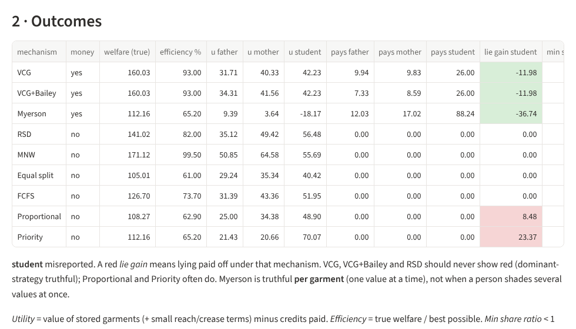

# Fold & Place

**Computer vision, optimisation and mechanism design for a family wardrobe.**
Fold & Place recognises Indian and Western garments from photos, works out every sensible way to
fold each one, packs everything into an Indian almirah with an exact solver, and decides how a
family should share the space when not everything fits and each person is tempted to say their
clothes matter most.

<p align="center">
  
  
</p>

## What it does

| Stage | How | Where |
|---|---|---|
| **See** | Photo → category (31 types: 17 Western, 14 Indian), fabric, embellishment, flat size. Marqo-FashionSigLIP zero-shot + a head trained on IndoFashion and Myntra; rembg / SegFormer masks; size from an A4 sheet or ArUco marker (homography), else the size chart. | `fold_and_place/vision/` |
| **Fold** | Exact polygon folding (shapely). Sides-in, board fold, leg-over-leg, saree accordion, rolls, hanging - each as a stacked or KonMari-filed packet with size, plies and creases. | `fold_and_place/folding/` |
| **Place** | OR-Tools CP-SAT chooses one fold and one spot per garment: shelves as stacks, drawers as filed rows, rails as hangers. Maximises stored value, then easy reach for frequently worn clothes (golden zone), then fewer creases on delicate fabrics. | `fold_and_place/storage/` |
| **Share** | People report private values. VCG, VCG + Bailey redistribution, Myerson knapsack auction, random serial dictatorship, maximum Nash welfare and four naive rules turn reports into plans; we measure efficiency, envy and who gains by lying. Shapley value splits the cost of a shared wardrobe. | `fold_and_place/mechanisms/` |

A six-page Streamlit dashboard ties it together, with a 3D animation of every fold.

## Results

From `make experiments` (details in [`results/`](results) and the dashboard's Experiments page).

| | Result |
|---|---|
| Fold geometry (E1) | Board fold matches the 23 × 30.5 cm department-store board exactly; area conserved to 1e-15; loft factor calibrated at 1.18 |
| Size from a photo (E3) | Mean error 2.3 cm (width), 1.9 cm (length) on 144 synthetic photos with up to 25° tilt |
| Optimizer vs rules of thumb (E4) | vs traditional flat stacks: **−24% reach effort, −64% crease load, +23 items stored**; vs KonMari filing: −47% / −65%. Proven optimal on 6 of 8 instances (worst gap 0.02%) |
| Mechanisms (E5) | VCG: 100% efficient, 0/60 profitable lies. RSD: 82%, 0/15. Max Nash welfare: 99.5%. *Priority by claimed value*: 72%, **160/300 profitable lies** |
| Strategic play (E7) | When everyone best-responds, *Proportional to claims* falls to 0.64 of optimum (everyone claims ×3); VCG stays at 1.0 |
| Who pays (E6) | One shared two-door (₹16,000) instead of separate wardrobes (₹34,000). Shapley split ₹3k / ₹10k / ₹3k is the only rule tested that is in the core |
| Recognition (E2) | Run `make data embeddings` - needs the public datasets (see [DATA.md](DATA.md)) |

<p align="center">
  
  <br><em>Mechanism lab: the student claims 3× their true values. Under VCG the lie costs them 12 points; under Priority it gains 23.</em>
</p>

## Run it (macOS on Apple silicon, or Linux)

Needs Python 3.10+ (`brew install python@3.12` if `python3 --version` is older).

```bash
git clone https://github.com/arnavhm/fold-and-place.git
cd fold-and-place

make setup-core            # numpy, shapely, OR-Tools, Streamlit (a few minutes)
make app                   # dashboard at http://localhost:8501
```

Everything except photo analysis works with `setup-core`. For the vision stack and the
recognition experiment:

```bash
make setup                 # adds torch, open_clip, transformers, rembg, OpenCV (~2 GB)
make data                  # public datasets from Kaggle; needs ~/.kaggle/kaggle.json
make embeddings            # embeds a balanced sample, trains the head, writes results/E2_*
make smoke                 # checks the models on the bundled sample images
```

Re-run every experiment (writes `results/`): `make experiments` (a few minutes; E2 is skipped
until the embeddings exist). Tests and lint: `make test`, `make lint`. If `python3` is not the one
you want: `make setup PYTHON=python3.12`.

## Dashboard

| Page | |
|---|---|
| Wardrobe | Indian presets (one-door to sliding, plus a compact shared section), golden zone, editable compartments |
| Garments | The demo family's 97 garments, editable; add one from a photo |
| Plan | Optimizer vs four baselines, independent checker, a reason for every placement, CSV export |
| Fold studio | Every fold option for a garment, 3D animation, 2D step diagrams, standalone HTML download |
| Mechanism lab | Make anyone lie and compare nine mechanisms: welfare, payments, fairness, gain from lying |
| Experiments | Notes, figures and tables for E1-E7 |

<p align="center"></p>

## Repository

```
fold_and_place/
  garments/      garment record and the demo household
  folding/       outlines, fold engine, fold options, calibration
  storage/       wardrobe model, CP-SAT optimizer, baselines, checker
  mechanisms/    scenario, nine mechanisms, fairness, strategic tests, Shapley
  vision/        embeddings, segmentation, measurement, photo -> garment
  experiments/   E1-E7
  app/           Streamlit dashboard and 3D fold viewer
configs/         categories, fabrics, wardrobe presets, personas (all assumptions labelled)
scripts/         data download, embeddings, experiments, sample rendering
results/         experiment outputs
docs/            design.md (method), demo_script.md (recording walkthrough)
tests/           130 tests
```

## Assumptions and limits

The demo family's garments, values and wear rates are labelled assumptions; fabric thicknesses
are partly estimates; folding is geometry, not cloth physics; effort weights are modelling choices
with a sensitivity check in E4. No personal photos are used: sample images are rendered by
`scripts/make_samples.py` and training images come from public datasets. See
[docs/design.md](docs/design.md) section 7.

## Credits

Marqo-FashionSigLIP (Apache-2.0), SegFormer-B2 clothes (MIT), rembg (MIT), IndoFashion
(Rajput & Aneja, CVPRW 2021), Myntra Fashion Product Images (Kaggle), OR-Tools (Apache-2.0),
three.js (MIT, vendored in `fold_and_place/app/static/`). Details in [DATA.md](DATA.md).
