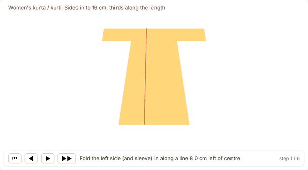
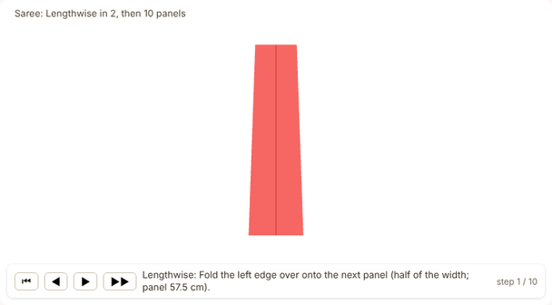
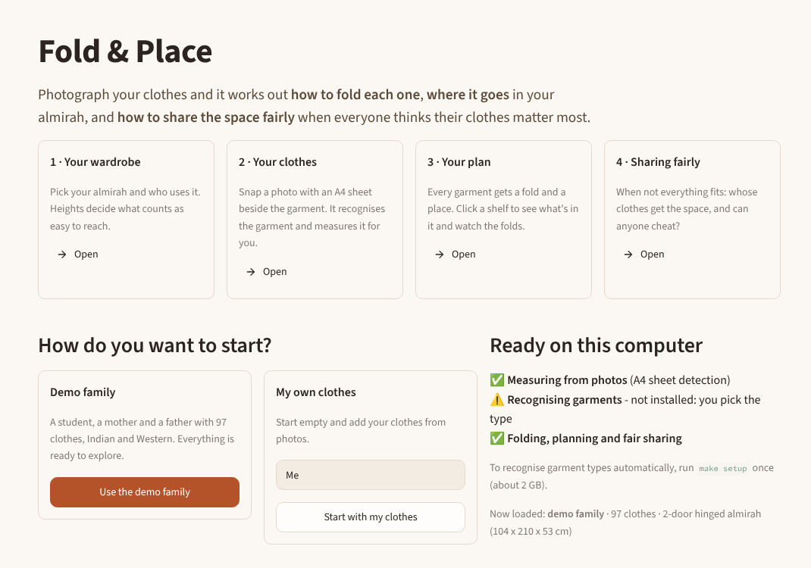
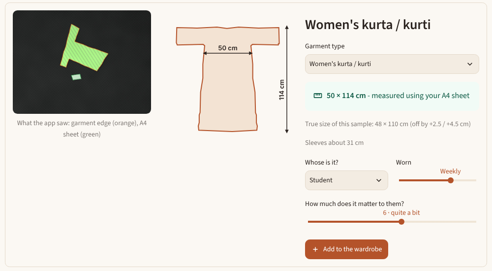
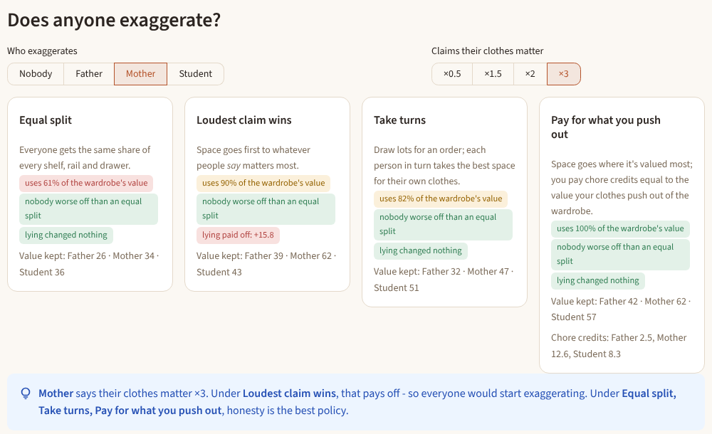
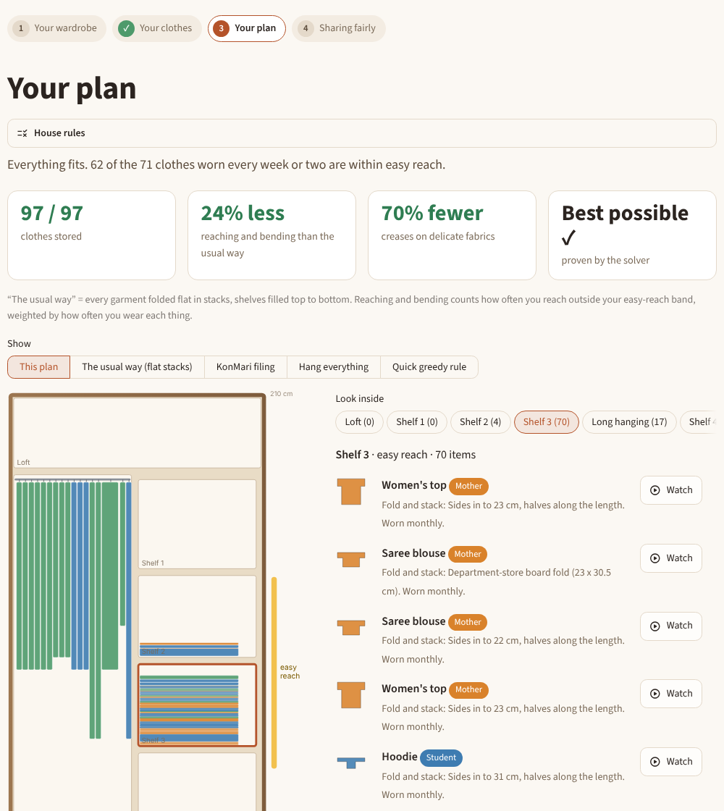

# Fold & Place

**Computer vision, optimisation and mechanism design for a family wardrobe.**
Fold & Place recognises Indian and Western garments from photos, works out every sensible way to
fold each one, packs everything into an Indian almirah with an exact solver, and decides how a
family should share the space when not everything fits and each person is tempted to say their
clothes matter most.

<p align="center">
  
  
</p>

## What it does

| Stage | How | Where |
|---|---|---|
| **See** | Photo → category (31 types: 17 Western, 14 Indian), fabric, embellishment, **measured size and outline**. Lay the garment flat with any A4 sheet beside it: the sheet is found automatically, the view straightened, the garment cut out and turned upright from any angle, then measured - no tape measure. Without a sheet the size is an estimate from the photo's proportions and the size label. Marqo-FashionSigLIP zero-shot + a head trained on IndoFashion and Myntra; rembg / SegFormer masks. | `fold_and_place/vision/` |
| **Fold** | Exact polygon folding (shapely) of the garment's own photographed outline. Sides-in, board fold, leg-over-leg, saree accordion, rolls, hanging - each as a stacked or KonMari-filed packet with size, plies and creases. | `fold_and_place/folding/` |
| **Place** | OR-Tools CP-SAT chooses one fold and one spot per garment: shelves as stacks, drawers as filed rows, rails as hangers. Maximises stored value, then easy reach for frequently worn clothes (each person's height sets their easy-reach band), then fewer creases on delicate fabrics. House rules: personal shelves, pack winter clothes away, heavy things low. | `fold_and_place/storage/` |
| **Share** | People report private values. VCG, VCG + Bailey redistribution, Myerson knapsack auction, random serial dictatorship, maximum Nash welfare and four naive rules turn reports into plans; we measure efficiency, envy, who gains by lying alone and which pairs gain by lying together. Payments are chore credits. Shapley value splits the cost of a shared wardrobe. | `fold_and_place/mechanisms/` |

A guided dashboard ties it together in four steps - your wardrobe, your clothes, your plan, sharing
fairly - with a 3D animation of every fold.

<p align="center"></p>

## Results

From `make experiments` (details in [`results/`](results) and the dashboard's Experiments page).

| | Result |
|---|---|
| Fold geometry (E1) | Board fold matches the 23 × 30.5 cm department-store board exactly; area conserved to 1e-15; loft factor calibrated at 1.18 |
| Size from a photo (E3) | Whole chain on 54 realistic synthetic photos (textured sheets, prints, shadows, any rotation, up to 25° tilt): **A4 sheet found in all 54, median error 1 cm**, mean 1.5 cm width / 1.8 cm length. Without a sheet: about 5% |
| Real photos (E8) | Your own phone photos with tape-measured sizes: drop them in `data/real/` and run E8 (see [DATA.md](DATA.md)) |
| Optimizer vs rules of thumb (E4) | vs traditional flat stacks: **−24% reach effort, −64% crease load, +23 items stored**; vs KonMari filing: −47% / −65%. Proven optimal on 6 of 8 instances (worst gap 0.02%) |
| Mechanisms (E5) | VCG: 100% efficient, 0/60 profitable lies. RSD: 82%, 0/15. Max Nash welfare: 99.9%. *Priority by claimed value*: 72%, **160/300 profitable lies** |
| Strategic play (E7) | When everyone best-responds, *Proportional to claims* falls to 0.64 of optimum (everyone claims ×3); VCG stays at 1.0 |
| Who pays (E6) | One shared two-door (₹16,000) instead of separate wardrobes (₹34,000). Shapley split ₹3k / ₹10k / ₹3k is the only rule tested that is in the core |
| Recognition (E2) | Run `make data embeddings` - needs the public datasets (see [DATA.md](DATA.md)) |

<p align="center">
  
  <br><em>Adding a garment from a photo: the A4 sheet is found (green), the garment cut out (orange), turned upright and measured.</em>
</p>
<p align="center">
  
  <br><em>Sharing fairly: Mother claims her clothes matter 3×. "Loudest claim wins" rewards it (+15.8); VCG and taking turns don't.</em>
</p>

## Run it (macOS on Apple silicon, or Linux)

Needs Python 3.10+ (`brew install python@3.12` if `python3 --version` is older).

```bash
git clone https://github.com/arnavhm/fold-and-place.git
cd fold-and-place

make setup-core            # numpy, shapely, OR-Tools, Streamlit, OpenCV (a few minutes)
make app                   # dashboard at http://localhost:8501
```

`setup-core` already measures garments from photos (you pick the garment type). To have the type
recognised automatically, and for the recognition experiment:

```bash
make setup                 # adds torch, open_clip, transformers, rembg, OpenCV (~2 GB)
make data                  # public datasets from Kaggle; needs ~/.kaggle/kaggle.json
make embeddings            # embeds a balanced sample, trains the head, writes results/E2_*
make smoke                 # checks the models on the bundled sample images
```

Re-run every experiment (writes `results/`): `make experiments` (a few minutes; E2 is skipped
until the embeddings exist, E8 until you add photos to `data/real/`). Tests and lint: `make test`, `make lint`. If `python3` is not the one
you want: `make setup PYTHON=python3.12`.

## Dashboard

| Step | |
|---|---|
| Start | Demo family (97 clothes) or your own household; what this computer can do |
| 1 · Your wardrobe | Indian presets with drawings and prices, who uses it (heights set each person's easy-reach band), editable shelves |
| 2 · Your clothes | Add from photos (upload several, phone camera, or rendered samples with known sizes): what the app saw, measured outline, type with confidence; garment cards to edit |
| 3 · Your plan | Plans automatically; compared with the usual way; look inside any shelf, watch any garment fold in 3D; house rules; printable shelf-by-shelf plan |
| 4 · Sharing fairly | Make someone exaggerate and see which rules reward it; chore credits; can two people team up? All nine rules under "Show the maths" |
| Behind the scenes | Fold any garment, the experiments, how it works |

<p align="center"></p>

## Repository

```
fold_and_place/
  garments/      garment record and the demo household
  folding/       outlines, fold engine, fold options, calibration
  storage/       wardrobe model, CP-SAT optimizer, house rules, baselines, checker
  mechanisms/    scenario, nine mechanisms, fairness, strategic tests, Shapley
  vision/        A4 sheet finder, segmentation, upright + measure + outline, recognition, realistic test photos
  experiments/   E1-E8
  app/           Streamlit dashboard (app.py, views/) and 3D fold viewer
configs/         categories, fabrics, wardrobe presets, personas (all assumptions labelled)
scripts/         data download, embeddings, experiments, sample rendering
results/         experiment outputs
docs/            design.md (method), demo_script.md (recording walkthrough)
tests/           143 tests
```

## Assumptions and limits

The demo family's garments, values and wear rates are labelled assumptions; fabric thicknesses
are partly estimates; folding is geometry, not cloth physics; effort weights are modelling choices
with a sensitivity check in E4. No personal photos are used: sample images are rendered by
`scripts/make_samples.py` and training images come from public datasets. See
[docs/design.md](docs/design.md) section 7.

## Credits

Marqo-FashionSigLIP (Apache-2.0), SegFormer-B2 clothes (MIT), rembg (MIT), IndoFashion
(Rajput & Aneja, CVPRW 2021), Myntra Fashion Product Images (Kaggle), OR-Tools (Apache-2.0),
three.js (MIT, vendored in `fold_and_place/app/static/`). Details in [DATA.md](DATA.md).
